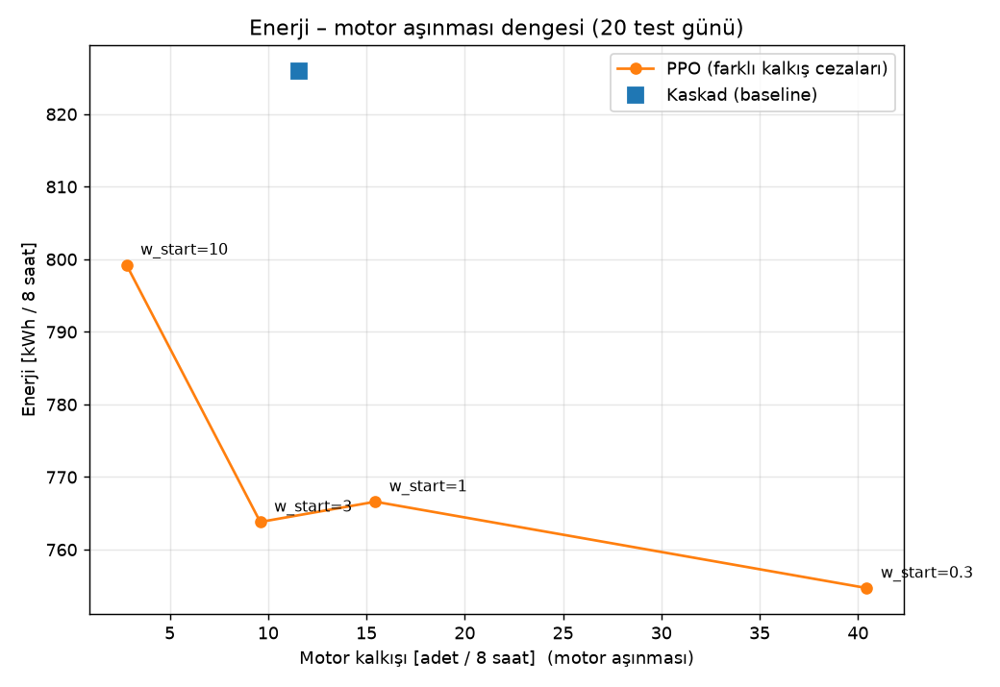
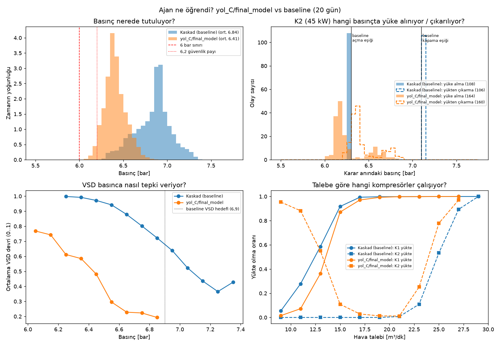
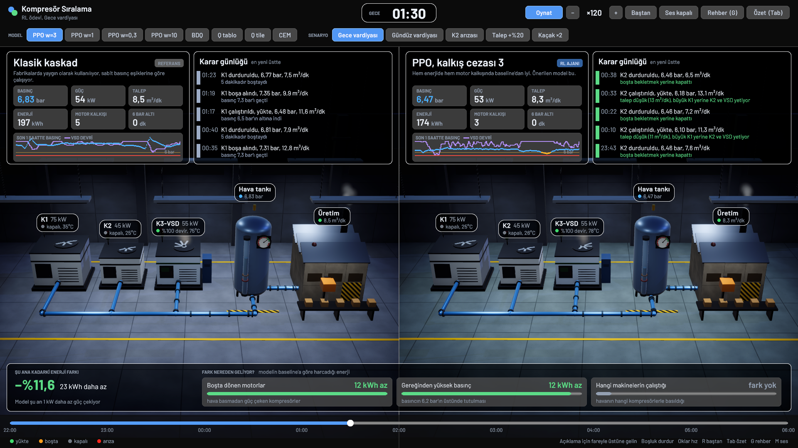
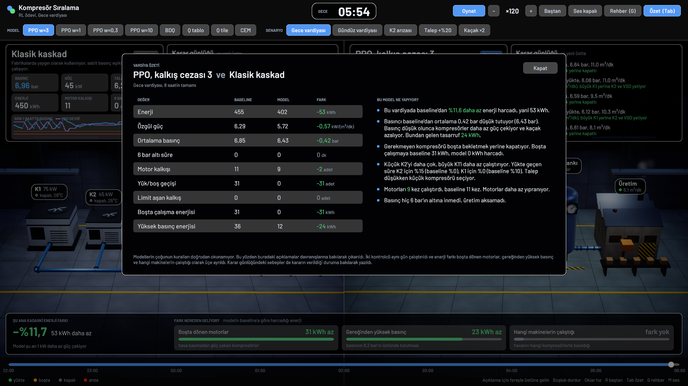
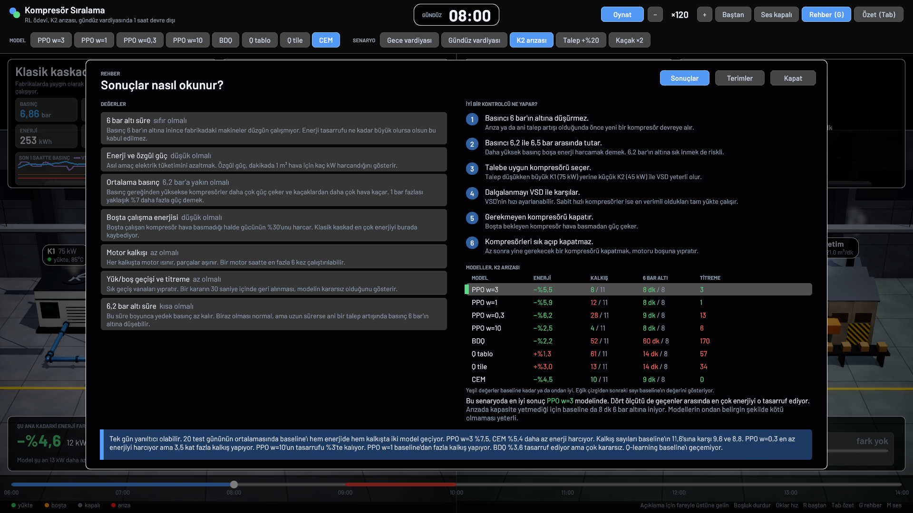

# Basınçlı Hava Sistemlerinde Pekiştirmeli Öğrenme ile Kompresör Sıralaması

Fabrikalarda basınçlı hava genellikle birkaç kompresörle üretilir ve bu kompresörler çoğu tesiste sabit basınç eşiklerine dayanan basit kurallarla yönetilir. Bu çalışmada aynı görevi pekiştirmeli öğrenme (reinforcement learning, RL) ile öğrenen kontrolcüler incelenmiştir. Gerçek bir tesiste deneme yapılamadığı için fiziksel modele dayanan bir simülatör yazılmıştır.

Klasik RL yöntemlerinden tablo tabanlı Q-learning ve SARSA, tile coding ve çapraz entropi yöntemi (cross-entropy method, CEM), derin RL yöntemlerinden PPO ve BDQ denenmiştir. Bütün yöntemler fabrikalarda kullanılan kaskad kontrol ile aynı 20 test gününde karşılaştırılmıştır. Kaskad kontrol bu çalışmada karşılaştırma ölçütü (baseline) olarak kullanılmıştır.

Tablo tabanlı yöntemler ve tile coding ilk denemelerde baseline'dan fazla enerji harcamıştır. Bunun ana nedeninin keşif planı olduğu bulunmuş ve düzeltilmiş eğitimle Q tablosu baseline'dan %7,1 daha az enerji harcamıştır. Bu tablo motorları sık çalıştırdığı için kalkış cezası artırılarak yeniden eğitilmiş ve enerji ile kalkış sayısı arasındaki denge ölçülmüştür. CEM ile ayarlanan kaskad kontrol enerjiyi %5,4 azaltmış ve kalkış sayısını da düşürmüştür. Derin RL'de en iyi sonucu veren PPO modeli enerjiyi %7,5 azaltmış ve baseline'dan daha az kalkış yapmıştır. Modeller eğitimde görmedikleri arıza, talep artışı ve kaçak gibi durumlarda da test edilmiştir. Sonuçlar Unity ile hazırlanan 3B bir uygulamada yan yana izlenebilir.

## İçindekiler

1. [Problem](#1-problem)
2. [Simülasyon](#2-simülasyon)
3. [Problemin RL olarak tanımı](#3-problemin-rl-olarak-tanımı)
4. [Değerlendirme](#4-değerlendirme)
5. [Klasik RL](#5-klasik-rl)
6. [Derin RL](#6-derin-rl)
7. [Bütün yöntemlerin karşılaştırılması](#7-bütün-yöntemlerin-karşılaştırılması)
8. [Eğitimde görülmeyen durumlar](#8-eğitimde-görülmeyen-durumlar)
9. [Unity ile görselleştirme](#9-unity-ile-görselleştirme)
10. [Sonuç](#10-sonuç)
11. [Kurulum ve dosyalar](#11-kurulum-ve-dosyalar)

## 1. Problem

Fabrikalarda pnömatik silindirler, presler ve el aletleri basınçlı havayla çalışır. Hava kompresörler tarafından basılır ve bir tankta birikir. Fabrika tanktan hava çektikçe basınç düşer, kompresörler hava bastıkça yükselir. Basınç 6 bar'ın altına indiğinde makineler düzgün çalışamaz.

Bir fabrikada genellikle farklı büyüklükte birkaç kompresör bulunur. Hangi anda hangi kompresörlerin çalışacağına karar verilmesi kompresör sıralaması (compressor sequencing) olarak adlandırılır. Çoğu tesiste bu karar kaskad kontrol ile verilir. Kaskad kontrolde her kompresörün bir alt ve bir üst basınç eşiği vardır. Basınç alt eşiğin altına indiğinde kompresör hava basmaya başlar, üst eşiği geçtiğinde hava basmayı bırakır.

Bu kurallar basit ve güvenlidir ama gereğinden fazla enerji harcar. Talep en yüksekken bile basıncın yetmesi için eşikler yüksek tutulur. Basınç yükseldikçe kompresörler daha fazla güç çeker ve kaçaklardan daha fazla hava kaybedilir. Hava basmayı bırakan kompresör de hemen durmaz. Bir süre boşta döner ve hava basmadığı halde gücünün yaklaşık %30'unu çeker. Kurallar talebi de dikkate almaz. Örneğin gece talep düşükken küçük kompresör yeterli olduğu halde büyük kompresör çalışabilir.

Bu çalışmadaki kontrolcülerden üç şey beklenir. Basınç 6 bar'ın altına düşmemeli, harcanan enerji olabildiğince az olmalı ve motorlar sık açılıp kapatılmamalıdır. Kapalı bir motorun çalıştırılması kalkış olarak adlandırılır. Her kalkış motoru ısıtıp yıprattığı için bir motorun saatte 6'dan fazla çalıştırılması cezalandırılır.

## 2. Simülasyon

Gerçek bir tesiste deneme yapılamadığı için Python'da bir simülatör yazılmıştır (`compressor_env/`). Simülatör, RL kütüphanelerinin kullandığı Gymnasium arayüzüne uyar. Her 10 saniyede kompresörlerin bastığı hava, fabrikanın tükettiği hava, tank basıncı ve harcanan elektrik hesaplanır. Bir bölüm (episode), simülasyonun 8 saat boyunca bir kez çalıştırılmasıdır ve 2880 adımdan oluşur.

Basınç için basit bir tank modeli kullanılmıştır. Formülde V tankın hacmini (20 m³), P_atm atmosfer basıncını, Q_basılan kompresörlerin bastığı hava debisini, Q_tüketilen ise fabrikanın çektiği hava debisini gösterir.

```
dP/dt = (P_atm / V) * (Q_basılan - Q_tüketilen)
```

Sistemde üç kompresör bulunur.

| Kompresör | Güç [kW] | Debi [m³/dk] | Çalışma şekli |
|---|---|---|---|
| K1 | 75 | 13 | sabit hızlı, kapalı, boşta ya da yükte |
| K2 | 45 | 7,5 | sabit hızlı, kapalı, boşta ya da yükte |
| VSD | 55 | 9,5 | devri ayarlanabilir, kapalı ya da 5 devir kademesinden birinde |

Yükteki kompresör tam güçle hava basar. Boştaki kompresör hava basmadan döner ve gücünün %30'unu çeker. VSD (variable speed drive) kompresörünün devri ayarlanabildiği için ihtiyaç kadar hava basabilir. Devri %20'nin altına inemez ve düşük devirde birim hava için daha fazla güç harcar.

Modelde gerçek sistemlerdeki bazı etkiler de bulunur. Basınç 1 bar arttığında kompresörlerin gücü %7 artar. Kaçak ve tüketim de basınçla birlikte artar. Motorlar çalıştıkça ısınır ve her kalkış motoru ayrıca ısıtır. Motor sıcaklığı 105 °C'yi geçtiğinde motor kendini korumak için kapanır (trip) ve 10 dakika açılamaz. 8 bar'ın üstünde kompresörler yüke alınamaz ve 8,5 bar'da emniyet ventili açılır.

Hava talebi her bölüm için yeniden üretilir (`compressor_env/demand.py`). Ortalama talep gece yaklaşık 6, gündüz 20, akşam 15 m³/dk'dır. Molalarda ve öğle arasında talep düşer. Bunun üstüne rastgele zamanlarda devreye giren makineler ve küçük dalgalanmalar eklenir. Her bölüm günün rastgele bir saatinde başlar ve tanktaki başlangıç basıncı da rastgele seçilir. Böylece her gün farklı olur ve ajan tek bir günü ezberleyemez. Simülatörün bütün ayarları `compressor_env/env.py` dosyasındaki `EnvConfig` sınıfında tanımlanmıştır.

## 3. Problemin RL olarak tanımı

RL'de bir ajan ortamı gözlemleyerek bir hareket seçer ve ortam ajana bir ödül verir. Ajan zamanla toplam ödülü en büyük yapacak davranışı öğrenir.

Ajan her 10 saniyede 22 sayıdan oluşan bir gözlem alır. Gözlemde tank basıncı, basıncın son adımdaki değişimi, hava talebi ve günün saati bulunur. Saat sin ve cos olarak verildiği için 23.59 ile 00.00 birbirine yakın görünür. Gözlemde ayrıca her kompresörün durumu, motor sıcaklığı, son bir saatteki kalkış sayısı ve trip sonrası kilit süresi yer alır. Bazı deneylerde gözleme son bir dakikadaki talep değişimi ve her kompresörün o anki durumunda ne kadar süredir kaldığı olmak üzere dört sayı daha eklenmiştir.

Ajan her adımda üç kompresöre aynı anda komut verir. K1 ve K2 için kapalı, boşta ya da yükte, VSD için kapalı ya da 5 devir kademesinden biri seçilir. Böylece 3 × 3 × 6 = 54 farklı komut kombinasyonu oluşur. Örneğin ajan aynı adımda K1'i yüke alıp K2'yi kapatabilir ve VSD'yi %60 devire getirebilir.

Ödül her adımda cezaların toplamı olarak hesaplanır ve ajan bu cezaları azaltmaya çalışır.

| Ceza | Ne zaman verilir | Büyüklük |
|---|---|---|
| Enerji | her adımda | çekilen toplam güç bölü 175 kW, 0 ile 1 arası |
| Düşük basınç | basınç 6 bar'ın altındayken | adım başına 3'ten başlar, basınç düştükçe artar |
| Güvenlik payı | basınç 6,0 ile 6,2 bar arasındayken | adım başına 0 ile 0,5 arası |
| Motor kalkışı | kapalı bir motor çalıştırıldığında | w (0,3 ile 10 arasında denenmiştir) |
| Yük ve boş geçişi | kompresör yükten boşa ya da boştan yüke geçtiğinde | 0,2 |
| Kalkış limiti | bir motor saatte 6'dan fazla çalıştırıldığında | 2 |
| Trip | motor aşırı ısınıp kapandığında | 10 |

Enerji cezasındaki 175 kW üç kompresörün tam güçlerinin toplamıdır. Örneğin kompresörler toplam 124 kW çektiğinde ceza yaklaşık 0,71 olur. Talep ajanın kontrolünde olmadığı için toplam enerjinin azaltılması, aynı havanın daha az enerjiyle basılması anlamına gelir. Bu ölçekte 1 kWh enerji yaklaşık 2,06 ceza puanına karşılık gelir.

Karşılaştırma için kaskad kontrol baseline olarak kullanılmıştır (`compressor_env/baseline.py`). K1 basınç 6,5 bar'ın altına indiğinde yüke alınır ve 7,3 bar'ı geçtiğinde boşa alınır. K2'nin eşikleri biraz daha aşağıda, 6,3 ve 7,1 bar'dadır. Boşta 5 dakika kalan kompresör kapatılır. VSD'nin devri bir PI kontrolcü ile ayarlanır ve basınç 6,9 bar'da tutulmaya çalışılır. PI kontrolcü devri, hedef basınç ile ölçülen basınç arasındaki farka ve bu farkın zaman içinde birikmiş toplamına göre değiştirir.

## 4. Değerlendirme

Bütün kontrolcüler aynı 20 test gününde çalıştırılmıştır (`evaluate.py`). Her günün talebi, rastgele sayı üretecinin başlangıç değerinden (seed) üretilir. Test günlerinin seed'leri 12345 ile 12364 arasındadır ve eğitimde kullanılan günlerden farklıdır. Tablolardaki değerler bu 20 günün ortalamasıdır.

| Ölçüt | Anlamı | İyi olan |
|---|---|---|
| Enerji [kWh] | 8 saat boyunca harcanan elektrik | düşük |
| Özgül güç [kW/(m³/dk)] | dakikada 1 m³ hava basmak için harcanan güç | düşük |
| Ortalama basınç [bar] | 8 saat boyunca ortalama basınç | 6,2'nin biraz üstünde |
| 6 bar altı [dk] | basıncın 6 bar'ın altında kaldığı süre | sıfır |
| 6,2 bar altı [dk] | basıncın 6,2 bar'ın altında kaldığı süre | kısa |
| Motor kalkışı | kapalı motorların kaç kez çalıştırıldığı | az |
| Yük ve boş geçişi | kompresörlerin yük ile boş arasında kaç kez geçtiği | az |
| Limit aşan kalkış | saatte 6 kalkış sınırının kaç kez aşıldığı | sıfır |

Ölçütler arasında önceliği 6 bar altında geçen süre taşır. Basıncı 6 bar'ın altına düşüren bir kontrolcü, enerji tasarrufu ne kadar yüksek olursa olsun kabul edilemez. 6,2 bar altında geçen süre de güvenlik payının ne kadar inceldiğini gösterir. Basınç uzun süre 6,2 bar'ın altında kaldığında ani bir talep artışı basıncı 6 bar'ın altına düşürebilir.

Baseline 20 günün ortalamasında 825,9 kWh harcamış ve 11,6 kalkış yapmıştır. Basınç hiçbir günde 6,2 bar'ın altına inmemiştir.

## 5. Klasik RL

Problem önce sinir ağı kullanılmadan klasik RL yöntemleriyle ele alınmıştır. Bu yöntemler Sutton ve Barto'nun Reinforcement Learning: An Introduction (2018) kitabından alınmıştır. İlk olarak tablo tabanlı Q-learning ve SARSA, ardından tile coding denenmiştir. İki yöntem de ilk denemelerde baseline'ı geçemediği için tabloların neden başarısız olduğu ayrıca incelenmiş ve eğitim buna göre düzeltilmiştir. Sistemde ne kadar tasarruf payı olduğunu görmek için de CEM kullanılmıştır.

### 5.1 Tablo tabanlı Q-learning ve SARSA

Bu yöntemde ajanın öğrendikleri bir tabloda tutulur. Tablonun satırları durumlara, sütunları hareketlere karşılık gelir. Her hücredeki Q değeri, o durumda o hareket yapıldığında bundan sonra toplanacak ödülün tahminidir. Ajan her durumda Q değeri en yüksek hareketi seçer. Yeni hareketleri de denemesi için epsilon olasılıkla rastgele bir hareket yapar (epsilon-greedy). İlk tablolarda epsilon 24 milyon adım boyunca 1'den 0,01'e doğrusal olarak azaltılmıştır.

Ajan bir hareket yapıp ödülü ve yeni durumu gördüğünde ilgili hücreyi günceller. Hücrenin değeri, alınan ödül ile yeni durumun değerinin toplamına doğru bir miktar kaydırılır. Q-learning ve SARSA yeni durumun değerini farklı şekilde alır. Yeni durumda en iyi hareketin değerinin −50, ajanın rastgele seçtiği hareketin değerinin −80 olduğu varsayılsın. Q-learning güncellemede −50'yi, SARSA ise gerçekten yapılacak hareketin değeri olan −80'i kullanır. Bu nedenle SARSA keşif sırasındaki rastgele hareketlerin riskini de öğrenir ve daha temkinli davranır.

Basınç 6,83 ya da 6,91 gibi sonsuz sayıda değer alabildiği için her değere ayrı satır açılamaz. Bu nedenle her bilgi birkaç aralığa bölünmüştür (`klasik_rl.py`).

| Bilgi | Aralık sayısı |
|---|---|
| Basınç (sınırlar 6,0 ile 7,3 bar arasında) | 8 |
| Basıncın değişimi | 5 |
| Talep | 6 |
| En çok kalkış yapan motorun son bir saatteki kalkış sayısı | 3 |
| K1 ve K2'nin durumu | 3'er |
| VSD'nin durumu | 6 |

Talep sınırları kompresör kapasitelerine göre seçilmiştir. Örneğin sınırlardan biri, VSD'nin tek başına basabildiği en fazla hava olan 9,5 m³/dk'dır. Aralık sayıları çarpıldığında tabloda 38880 satır oluşur. Günün saati, motor sıcaklıkları ve kilit süreleri tabloya alınmamıştır.

İlk denemede hareket olarak ortamın 54 komut kombinasyonu kullanılmış ve ajan her 10 saniyede karar vermiştir. 20 milyon adımdan sonra bile ajanın gördüğü durumlardaki hücrelerin %28'i hiç denenmemiştir. Tablo sıfırla başladığı için denenmemiş bir hareket, değeri hep eksi olan denenmiş hareketlerden daha iyi görünmüştür. Bu nedenle ajan sürekli yeni hareket denemiş, 8 saatte 444 kez motor çalıştırmış ve ortalama basınç 3,7 bar'da kalmıştır. Bunun üzerine üç değişiklik yapılmıştır.

- Hareketler o anki duruma göre tek bir değişiklik olarak tanımlanmıştır. Ajan ya hiçbir şeyi değiştirmez ya da tek bir kompresörde tek bir değişiklik yapar. Örneğin VSD'yi bir kademe hızlandırır ya da K2'yi boşa alır. Böylece hareket sayısı 54'ten 9'a inmiştir.
- Seçilen hareket 30 saniye uygulanır. İlk tablolarda basınç 6,2 bar'ın altına indiğinde bu süre dolmadan yeni karar verilmiştir. Bu kural elle eklenmiştir ve 5.4. bölümde kaldırılmıştır.
- En iyi hareket seçilirken yalnızca daha önce denenmiş hareketlere bakılır. Yeni hareketler rastgele keşif sırasında denenir. Hiç görülmemiş bir duruma geçildiğinde o durumun değeri sıfır alınmaz ve az önce alınan ödülün süreceği varsayılarak tahmin edilir.

Tablo büyüdükçe her hücrenin öğrenilmesi için daha fazla deneyim gerekir. Bu nedenle bazı bilgileri daha az aralığa bölen 10368 satırlık küçük bir tablo da denenmiştir. Eğitim 30 milyon adım, yaklaşık 10 bin bölüm sürmüştür. İlk tablo ve tile coding modellerinde kalkış cezası w=1 alınmıştır.

| | Baseline | Q-learning (büyük tablo) | SARSA (büyük tablo) | Q-learning (küçük tablo) | SARSA (küçük tablo) |
|---|---|---|---|---|---|
| Enerji [kWh] | 825,9 | 853,8 | 935,7 | 860,4 | 909,4 |
| Ortalama basınç [bar] | 6,84 | 6,83 | 7,26 | 6,81 | 7,18 |
| 6 bar altı [dk] | 0 | 3,1 | 0 | 0,8 | 0 |
| 6,2 bar altı [dk] | 0 | 20,1 | 0 | 17,3 | 0,1 |
| Motor kalkışı | 11,6 | 84,7 | 43,0 | 63,5 | 24,6 |
| Limit aşan kalkış | 0,1 | 16,2 | 0,1 | 8,4 | 4,0 |

Tablo tabanlı modellerin hepsi baseline'dan fazla enerji harcamış ve motorları çok daha sık açıp kapatmıştır. SARSA basıncı 7,2 bar civarında tutarak güvenli kalmış ama bunun için fazla enerji harcamıştır. Q-learning ise basıncı daha aşağıda tutmuş ve zaman zaman 6 bar'ın altına düşmüştür. Aynı fark Sutton ve Barto'nun kitabındaki cliff walking örneğinde de görülür (örnek 6.6). Bu örnekte Q-learning en kısa yolu uçurumun kenarından öğrenirken SARSA kenardan uzak durur.

Tabloların başarısızlığını incelemek için aynı ayarlarla iki küçük tablo eğitilmiştir. İki tablo arasındaki tek fark eğitimde karşılaştıkları rastgele günlerdir. İki tabloda da en az 10 kez güncellenen hücreler karşılaştırıldığında aynı hücrenin değeri iki tabloda ortalama 26 kadar farklı çıkmıştır. Bir durumda en iyi iki hareket arasındaki fark ise genellikle 0,03 civarındadır. Tahmindeki hata hareketler arasındaki farktan yaklaşık 900 kat büyük olduğu için iki tablo aynı durumda yalnızca %23 oranında aynı hareketi seçmiştir. Bu gürültünün nedeni ilk olarak rastgele talepte aranmıştır. Tek bir hareket yalnızca 30 saniye sürdüğü için toplam ödülü az etkiler, o günün talebi ise toplam ödülü çok daha fazla etkiler. 5.4. bölümde gürültünün büyük kısmının keşif planından kaynaklandığı gösterilmiştir.

Gürültüyü azaltmak için iki ayar daha denenmiştir. Eğitim 60 milyon adıma uzatıldığında kalkış sayısı 40'a inmiş ama enerji 881 kWh'e çıkmıştır. Öğrenme hızı her hücrede 1/n yapıldığında, n o hücrenin kaç kez güncellendiğini göstermek üzere, enerji 822 kWh ile baseline düzeyine inmiştir. Ancak kalkış sayısı 75'te kalmış ve saatlik limit 22 kez aşılmıştır.

### 5.2 Tile coding

Tabloda aralıkların sınırları keskindir. Örneğin 6,39 bar ile 6,41 bar birbirine çok yakın olduğu halde 6,4 bar sınırının iki yanında kaldıkları için farklı satırlara düşer. Bu nedenle birinde öğrenilen değer diğerine aktarılmaz. Tile coding bu sorun için kullanılan klasik bir yöntemdir (Sutton ve Barto, bölüm 9.5).

Tile coding'de durumların üstüne birbirine göre biraz kaydırılmış 8 ızgara konur. Her durum her ızgarada bir kutuya düşer ve her kutunun her hareket için bir ağırlığı vardır. Bir hareketin değeri, durumun düştüğü 8 kutunun ağırlıkları toplanarak bulunur. 6,39 ve 6,41 bar 8 kutudan 7'sini paylaştığı için birinde öğrenilen değer büyük ölçüde diğerine de geçer. Güncellemede durumun düştüğü 8 kutunun ağırlığı birlikte değiştirilir (Sutton ve Barto, bölüm 10.1).

Bütün bilgiler tek bir ızgaraya konsaydı ağırlık sayısı çok büyürdü. Bu nedenle bilgiler küçük gruplara ayrılmış ve her grup için ayrı ızgaralar kurulmuştur (`klasik_tile.py`). Örneğin bir grup basınç ile basıncın değişimine, bir başka grup talep ile günün saatine bakar. Kompresörlerin durumu zaten birkaç seçenekten oluştuğu için ızgaraya konmamış ve her kompresör durumu için ayrı kutular kullanılmıştır.

| | Baseline | Q-learning (tablo) | Q-learning (tile coding) | SARSA (tile coding, 4 ek gözlemle) |
|---|---|---|---|---|
| Enerji [kWh] | 825,9 | 860,4 | 845,0 | 963,7 |
| Ortalama basınç [bar] | 6,84 | 6,81 | 6,50 | 6,94 |
| 6 bar altı [dk] | 0 | 0,8 | 2,1 | 1,3 |
| 6,2 bar altı [dk] | 0 | 17,3 | 79,4 | 25,5 |
| Motor kalkışı | 11,6 | 63,5 | 18,1 | 23,6 |
| Limit aşan kalkış | 0,1 | 8,4 | 0 | 0,2 |

Tile coding kalkış sayısını 63'ten 18'e indirmiş ve saatlik limit hiç aşılmamıştır. Ancak enerji yine baseline'dan fazla olmuş ve basınç uzun süre 6,2 bar'ın altında kalmıştır. Kayıtlarda ajanın kompresörleri saatlerce boşta beklettiği görülmüştür. Boştaki kompresör hava basmadan güç çektiği için fazladan harcanan enerjinin büyük kısmı buradan gelir.

İlk olarak ajanın bir kompresörün ne zamandır boşta olduğunu bilmemesinin neden olduğu düşünülmüştür, çünkü baseline'ın "5 dakika boşta kalırsa kapat" kuralı bu bilgiye dayanır. Gözleme her kompresörün o anki durumunda ne kadar süredir kaldığı eklendiğinde sonuç daha da kötüleşmiş ve ajan K2'yi zamanın %89'unda boşta tutmuştur.

Bu davranışın keşifle ilgili olduğu düşünülmektedir. Boştaki bir kompresörü kapatmanın faydası hemen görülmez ve kompresör az sonra tekrar gerekirse kalkış cezası alınır. Kapatmanın kazançlı olduğunun görülmesi için ajanın kompresörü kapatıp bir süre kapalı tutması gerekir. Bu da birkaç doğru kararın arka arkaya verilmesi anlamına gelir. Epsilon-greedy keşifte her rastgele hareket birbirinden bağımsız seçildiği için böyle bir sıra çok nadir denenir.

### 5.3 Gamma ve uzun hareket denemesi

İlk analizde bulunan iki nedeni azaltmak için iki değişiklik denenmiştir.

İlk değişiklikte gamma küçültülmüştür. Gamma her 10 saniyelik adımda uygulandığı için 0,995 ile ajan yaklaşık 200 adım, 33 dakika ilerisine bakar. 0,98 ile bu süre 50 adıma, yaklaşık 8 dakikaya iner. Ajan daha kısa bir süreye baktığında uzak gelecekteki talep değişimleri değerlere daha az karışır. Buna karşılık ajan kararlarının uzak sonuçlarını daha az hesaba katar.

İkinci değişiklikte uzun hareketler kullanılmıştır (`klasik_rl.py --uzun`). K1 ve K2 hareketleri 30 saniye yerine 5 dakika uygulanır. Örneğin "K2'yi kapat" hareketi K2'yi kapatıp 5 dakika kapalı tutar ve kapatmanın faydası tek bir hareketin içinde görülür. Sutton ve Barto'nun kitabında bu tür uzun hareketler option olarak adlandırılır (bölüm 17.2). Uzun hareket süresince üç kompresörün komutu birlikte dondurulduğu için talep değiştiğinde basınç hızla düşebilir. Bu nedenle basınç 6,2 bar'ın altına indiğinde uzun hareket de yarıda kesilmiştir.

Her ayar küçük tabloyla ve iki farklı seed ile 30 milyon adım eğitilmiştir. Tablodaki değerler iki seed'in ortalamasıdır. İlk tablo tek seed ile eğitilmiştir.

| | Baseline | İlk tablo | Uzun hareket | Gamma 0,98 | Gamma 0,98 ve uzun hareket |
|---|---|---|---|---|---|
| Enerji [kWh] | 825,9 | 860,4 | 847,3 | 818,0 | 789,7 |
| Baseline'a göre | | +%4,2 | +%2,6 | −%1,0 | −%4,4 |
| 6 bar altı [dk] | 0 | 0,8 | 1,5 | 0,2 | 0,1 |
| 6,2 bar altı [dk] | 0 | 17,3 | 44,0 | 19,3 | 36,8 |
| Motor kalkışı | 11,6 | 63,5 | 58,4 | 61,4 | 40,3 |
| Limit aşan kalkış | 0,1 | 8,4 | 4,5 | 3,1 | 1,5 |

İki değişiklik birlikte kullanıldığında tablo baseline'dan %4,4 daha az enerji harcamış ve basınç neredeyse hiç 6 bar'ın altına inmemiştir. Ancak kalkış sayısı baseline'ın 3 katından fazladır. Ayrıca 6,2 bar kuralı kaldırıldığında basınç 8,7 dakika 6 bar'ın altında kalmıştır. Bu sonuç kuralın, donmuş komutun yol açtığı basınç düşüşünü örten bir yama olduğunu göstermiştir.

### 5.4 Keşif planının düzeltilmesi

Tablo modellerinin başarısızlığı, proje dosyalarından bağımsız bir analizle ayrıca incelenmiştir. Analizde kullanılan deneme kodu `analiz/kilit_rl.py` dosyasındadır. Analizde ana nedenin epsilon'un çok yavaş azaltılması olduğu bulunmuştur.

Epsilon 24 milyon adım boyunca doğrusal olarak azaltıldığı için 12 milyonuncu adımda bile hareketlerin yarısı rastgele seçilmiştir. Eğitimin ilk 6 milyon adımında basınç zamanın %64 ile 68'inde, 6 ile 12 milyon adım arasında ise %43 ile 48'inde 6 bar'ın altında kalmıştır. Tablodaki güncellemelerin %64'ü "6 bar altı" aralığına düşmüştür. Basıncın iyi kontrol edildiği durumlar ancak eğitimin son kısmında görülmüş ve öğrenme hızı o sırada 0,05'in altına inmiş olduğu için bu durumlar yeterince öğrenilememiştir. Bunun sonucunda tablo durumların değerini olduğundan yüksek tahmin etmiştir.

| Tablo | Tablodaki Q | Gerçek getiri |
|---|---|---|
| İlk küçük tablo (gamma 0,995) | −40,6 | −132,5 |
| Gamma 0,98 | −22,7 | −30,9 |
| Gamma 0,98, uzun hareket ve 6,2 bar kuralı | −30,1 | −31,8 |
| Yeni epsilon planı | −27,8 | −28,4 |

İkinci neden 6 bar civarındaki aralıkların kaba olmasıdır. İlk tablolarda 6 bar'ın altı tek bir aralık olduğu için 5,99 bar ile 3 bar aynı satıra düşmüştür.

Bu bulgulara göre tablo eğitiminde dört değişiklik yapılmıştır.

- Epsilon ilk 3 milyon adımda 1'den 0,1'e, sonra 24 milyonuncu adıma kadar 0,1'den 0,01'e indirilmiştir (`--eps-hizli 3000000`).
- Basınç sınırları 5,8, 6,0, 6,1, 6,2, 6,3, 6,4, 6,6, 6,8, 7,0 ve 7,3 bar olarak sıklaştırılmıştır (`--tablo kompakt2`, 14256 satır).
- Etkisi olmayan hareketler seçilemez hale getirilmiştir (`--maske`). Örneğin kapalı bir kompresör yeniden kapatılamaz.
- Uzun hareket ve 6,2 bar kuralı kaldırılmış, bütün hareketler 30 saniye uygulanmıştır (`--acil-yok`). Gamma 0,98 alınmıştır.

Bu ayarlarla dört seed eğitilmiştir. Kalkış cezası w=3 alınmıştır. Tablo baseline'dan %7,1 daha az enerji harcamış ve basınç 8 saatte ortalama 0,13 dakika 6 bar'ın altına inmiştir. 100 yeni günde (seed 50000 ve sonrası) enerji tasarrufu %7,0 olmuştur. Yeni planda en iyi iki hareketin değer farkının medyanı 0,15'ten 0,85'e çıkmıştır.

Farkın keşif planından geldiğini doğrulamak için aynı ayarlarla yalnızca eski epsilon planı kullanılarak bir kontrol eğitimi yapılmıştır. Eğitim sırasında her 1,5 milyon adımda tablonun bir kopyası alınmış ve 20 test gününde rastgele hareket yapılmadan çalıştırılmıştır. Yeni planla eğitilen tablo 4,5 milyon adımda basıncı korumayı öğrenmiş ve 6 milyonuncu adımdan sonra baseline'dan az enerji harcamıştır. Eski planla eğitilen tablo ise basıncı ancak 18 milyonuncu adımdan sonra koruyabilmiş ve eğitimin sonunda baseline ile aynı enerjiyi (825 kWh) harcamıştır.

Analizde Double Q-learning, kompresöre özel 5 dakikalık kilit, basınç değişiminin daha sık bölünmesi ve gamma 0,995 de denenmiş ve bunların hiçbiri sonucu iyileştirmemiştir. Hareket süresinin ajana seçtirildiği bir sürüm de denenmiştir (`--sure-sec`). Ajan uzun hareketi kararların yalnızca %0,6'sında seçmiştir, çünkü kısa hareket 30 saniye sonra yeniden seçim hakkı verdiği için her zaman en az uzun hareket kadar değerlidir.

### 5.5 Kalkış cezasının etkisi

Düzeltilmiş tablo enerjide baseline'ı geçmiş ama motorları baseline'ın yaklaşık 2,5 katı sık çalıştırmıştır. Kalkışların büyük kısmı K2'den gelir. K2 8 saatte ortalama 23 kez çalıştırılmış, kapalı kalma süresinin medyanı 6 dakika olmuştur.

Bunun nedeni ödül fonksiyonudur. Kalkış cezası 3 iken bir kalkış yaklaşık 1,5 kWh enerjinin cezasına eşittir. K2 boştayken 13,5 kW çektiği için 6,5 dakikadan uzun bir boşta bekleme, K2'yi kapatıp yeniden çalıştırmaktan daha pahalıdır. Kalkış cezası 6'ya çıkarıldığında bu süre 13, 10'a çıkarıldığında 22 dakika olur. Aynı tablo bu iki ceza değeriyle dörder seed kullanılarak yeniden eğitilmiştir.

| | Baseline | CEM | w=3 | w=6 | w=10 |
|---|---|---|---|---|---|
| Enerji [kWh] | 825,9 | 781,7 | 767,6 | 775,1 | 781,5 |
| Baseline'a göre | | −%5,4 | −%7,1 | −%6,2 | −%5,4 |
| Enerji, 100 yeni gün [kWh] | 819,6 | 776,1 | 762,2 | 770,6 | 777,6 |
| 6 bar altı [dk] | 0 | 0 | 0,13 | 0,02 | 0,01 |
| Motor kalkışı | 11,6 | 8,8 | 29,7 | 20,0 | 12,8 |
| Limit aşan kalkış | 0,1 | 0 | 1,1 | 0 | 0 |

Ceza arttıkça kalkış sayısı azalmış, enerji tüketimi ise artmıştır. w=6 ile eğitilen tablo enerjiyi %6,2 azaltırken saatlik kalkış limitini hiç aşmamıştır. w=10 ile kalkış sayısı baseline'a yaklaşmış ve enerji tasarrufu CEM ile aynı düzeye inmiştir. Kalkış cezasının hangi değerde seçileceği, bir motor kalkışının fabrikadaki bakım maliyetine bağlıdır.

### 5.6 Çapraz entropi yöntemi (CEM)

Sistemde en fazla ne kadar tasarruf payı olduğunu görmek için kaskadın kuralları aynen korunmuş ve yalnızca içindeki 9 sayı CEM ile ayarlanmıştır (`klasik_cem.py`). CEM, sayıları deneyerek en iyisini arayan bir optimizasyon yöntemidir. Sutton ve Barto'nun kitabında (bölüm 1.4) bu tür yöntemler evrimsel yöntemler olarak adlandırılır. CEM'in RL'de kullanılmasının bilinen bir örneği Szita ve Lőrincz'in (2006) Tetris çalışmasıdır.

CEM her turda bir normal dağılımdan 9 sayılık 60 aday çeker. Dağılımın ortalaması o ana kadarki en iyi tahmini, standart sapması ise adayların bu tahminden ne kadar uzağa düşebileceğini gösterir. Adayların hepsi aynı 16 eğitim gününde çalıştırılır ve ortalama ödülü en yüksek 12 aday seçilir. Dağılımın yeni ortalaması ve standart sapması bu 12 adaydan hesaplandığı için dağılım her turda iyi sayılara doğru kayar ve daralır. Arama baseline'ın sayılarından başlamış ve 30 tur, toplamda yaklaşık 29 bin bölüm sürmüştür. Arama 10 çekirdekte yaklaşık 12 dakika sürmüştür. CEM'de kalkış cezası w=3 alınmıştır.

Bütün adaylar aynı günlerde denendiği için talepteki rastgelelik bütün adayları aynı şekilde etkiler. Bu nedenle şanslı bir güne denk gelen aday öne geçemez.

| Sayı | Anlamı | Baseline | CEM |
|---|---|---|---|
| sp | VSD'nin tutmaya çalıştığı basınç [bar] | 6,9 | 6,54 |
| k1_on | K1'in yüke alındığı basınç [bar] | 6,5 | 6,17 |
| k1_off | K1'in boşa alındığı basınç [bar] | 7,3 | 7,75 |
| k2_on | K2'nin yüke alındığı basınç [bar] | 6,3 | 6,22 |
| k2_off | K2'nin boşa alındığı basınç [bar] | 7,1 | 6,75 |
| idle1 | K1'in kapatılmadan önce boşta beklediği süre [dk] | 5 | 2,1 |
| idle2 | K2'nin kapatılmadan önce boşta beklediği süre [dk] | 5 | 0,4 |
| kp | PI kontrolcünün farka verdiği ağırlık | 0,6 | 1,75 |
| ki | PI kontrolcünün birikmiş farka verdiği ağırlık | 0,004 | 0,006 |

| | Baseline | CEM |
|---|---|---|
| Enerji [kWh] | 825,9 | 781,7 |
| Özgül güç [kW/(m³/dk)] | 6,02 | 5,79 |
| Ortalama basınç [bar] | 6,84 | 6,54 |
| 6 bar altı [dk] | 0 | 0 |
| 6,2 bar altı [dk] | 0 | 0,6 |
| Motor kalkışı | 11,6 | 8,8 |
| Yük ve boş geçişi | 30,2 | 5,8 |
| Limit aşan kalkış | 0,1 | 0 |

CEM'in bulduğu sayılarla enerji %5,4 azalmış, kalkış sayısı da düşmüş ve basınç hiç 6 bar'ın altına inmemiştir. Tasarrufun büyük kısmı VSD'nin hedef basıncından gelir. Hedef 6,9 bar'dan 6,54 bar'a indiği için kompresörler daha az güç çeker ve kaçak azalır. K1'in boşa alma eşiği 7,75 bar'a çıkmıştır. Basınç bu değere neredeyse hiç ulaşmadığı için K1 sürekli yükte kalır ve basınca göre açılıp kapanan kompresör K2 olur. Boşa alınan K2 de 5 dakika yerine yaklaşık 24 saniye sonra kapatılır.

Sayıların günün saatine ve talebe göre değişebildiği bir sürüm de denenmiştir. Bu sürümde örneğin gece ve gündüz farklı hedef basınç kullanılabilir. İki farklı seed ile eğitilen bu sürüm sabit sayılı sürümden iyi sonuç vermemiştir. İki modelin enerjisi 778,8 ve 781,5 kWh olmuş ve basınç 4 ile 5 dakika arasında 6,2 bar'ın altında kalmıştır. Daha basit olduğu için sabit sayılı sürüm seçilmiştir.

CEM tam anlamıyla klasik bir RL yöntemi sayılmaz. Her adımda karar vermeyi öğrenen bir ajan yoktur ve CEM bir bölümün toplam ödülüne bakarak kuralın sayılarını dener. Kuralların yapısı da baseline'dan alınmıştır. Bu nedenle CEM'in sonucu, RL eğitimi yapılmadan sistemde ne kadar tasarruf payı olduğunu gösteren bir ölçüt olarak kullanılmıştır.

## 6. Derin RL

Bu bölümde tablo yerine sinir ağı kullanılmıştır. Sinir ağı 22 ya da 26 sayılık gözlemi aralıklara bölmeden olduğu gibi alır. Benzer durumlarda benzer çıktılar verdiği için tile coding'deki gibi bir genelleme kendiliğinden oluşur. İki yöntem denenmiştir. PPO her durumda hangi komutun verileceğini doğrudan öğrenir, BDQ ise Q-learning gibi her komutun değerini tahmin eder.

### 6.1 PPO

PPO (Proximal Policy Optimization) her durumda hangi komutun verileceğini bir sinir ağıyla öğrenir. Ağın bir kısmı komutu seçer, diğer kısmı durumun ne kadar iyi olduğunu tahmin eder. Her güncellemede davranış yalnızca biraz değiştirildiği için eğitim kararlı ilerler. Stable-Baselines3 kütüphanesi kullanılmıştır (`train_ppo.py`). Ağda 256 nöronlu iki katman bulunur ve eğitimde 8 ortam paralel çalıştırılmıştır.

Ödülün son halini bulmak için birkaç deneme yapılmıştır. İlk denemede yük ve boş geçişi cezası 0,03 iken ajan motorları hiç kapatmamış ve K1'i sürekli yük ile boş arasında gidip getirmiştir. Her geçişte kompresörün emiş vanası açılıp kapandığı için bu davranış vanayı aşındırır. Bu nedenle ceza 0,2'ye çıkarılmıştır.

İkinci denemede ajan baseline'dan %2 daha az enerji harcamış ama bunu basıncı tam 6 bar sınırında tutarak yapmıştır. Ani talep artışlarında basınç 6 bar'ın altına düşmüştür. Bunun üzerine 6,2 bar altı için güvenlik payı cezası eklenmiştir.

Üçüncü denemede 2 milyon adımdan sonra basınç güvenli kalmış, ancak ajan VSD'yi en düşük devirde bırakıp K1'i sürekli açıp kapatmış ve baseline'dan %11 fazla enerji harcamıştır. Eğitim 8 milyon adıma uzatıldığında enerji baseline'dan %8 az olmuş, ancak motor kalkışı baseline'ın 4 katına çıkmıştır.

Kalkışları azaltmak için üç değişiklik daha yapılmış ve her birinin etkisi ayrı ölçülmüştür.

| Aşama | Değişiklik | Enerji tasarrufu | Kalkış | Limit aşımı |
|---|---|---|---|---|
| Başlangıç | | %7,9 | 43,2 | 0,3 |
| A | kalkış cezası 0,3'ten 1'e çıkarıldı | %7,1 | 31,8 | 3,5 |
| B | gözleme talep değişimi ve durumda geçen süre eklendi | %8,0 | 18,9 | 0,9 |
| C | ödüller eğitim sırasında ölçeklendi, öğrenme hızı zamanla azaltıldı | %7,2 | 15,4 | 0,1 |

C ayarlarıyla 3 seed daha eğitilmiştir. Dört seed'in ortalamasında enerji tasarrufu %8,0 ± 0,6 olmuş ve hiçbir seed'de basınç 6 bar'ın altına inmemiştir.

### 6.2 BDQ

BDQ (Branching Dueling Q-Network), Q-learning'in sinir ağı kullanan bir sürümüdür (Tavakoli ve ark., 2018). Ağ her komutun Q değerini tahmin eder ve en yüksek olanı seçer. 54 komut kombinasyonunun her biri için ayrı bir çıktı kullanılmaz. Bunun yerine her kompresörün ağda kendi dalı vardır. K1 ve K2 dalları 3, VSD dalı 6 değer üretir. Ajanın yaşadığı geçişler bir hafızada (replay buffer) tutulur ve eğitimde tekrar tekrar kullanılır. BDQ PyTorch ile sıfırdan yazılmış (`bdq.py`) ve PPO'nun C ayarlarıyla 5 milyon adım eğitilmiştir.

BDQ baseline'dan %3,6 daha az enerji harcamış, ancak motorları 46 kez çalıştırmış ve saatlik limiti 8 kez aşmıştır. Kayıtlarda K1'in 10 saniye kapanıp hemen tekrar açıldığı görülmüştür. İki komutun Q değeri çok yakın olduğunda ajan ikisi arasında gidip gelmektedir. PPO'nun 8 paralel ortamla daha fazla deneyim görmesi de farkta etkili olmuş olabilir. BDQ'nun öğrenme hızı, keşif süresi ve hafıza boyutu ayrıca denenmemiştir.

### 6.3 Enerji ve motor aşınması dengesi

Kalkış cezası w büyüdükçe ajan motorları açıp kapatmaktan kaçınır ama enerji tasarrufu azalır. Bu dengeyi görmek için C ayarlarıyla w=0,3, w=3 ve w=10 olan üç PPO modeli daha eğitilmiş ve w=1 ile eğitilen C modeliyle karşılaştırılmıştır (`pareto.py`).

| | Baseline | w=0,3 | w=1 | w=3 | w=10 |
|---|---|---|---|---|---|
| Enerji [kWh] | 825,9 | 755 | 766,6 | 763,8 | 799 |
| Motor kalkışı | 11,6 | 40,5 | 15,4 | 9,6 | 2,8 |
| 6,2 bar altı [dk] | 0 | 23,8 | 14,7 | 17,0 | 5,3 |
| 6 bar altı [dk] | 0 | 0 | 0 | 0 | 0 |



w arttıkça kalkış sayısı 40'tan 3'e inmiş, enerji ise 755 kWh'ten 799 kWh'e çıkmıştır. Bir işletme motor aşınmasına verdiği öneme göre bu modellerden birini seçebilir. w=3 modeli baseline'dan hem %7,5 daha az enerji harcar hem de daha az kalkış yapar. w=1 ile w=3 arasındaki enerji farkı, farklı seed'lerle eğitilen modeller arasındaki farktan küçüktür.

### 6.4 Ajanın öğrendiği davranış

Sinir ağının içinden kural okunamadığı için w=1 ile eğitilen PPO modelinin davranışı 20 test gününde incelenmiştir (`interpret.py`).

| | Baseline | PPO |
|---|---|---|
| Ortalama basınç [bar] | 6,84 | 6,41 |
| Basıncın zamanın %90'ında kaldığı aralık [bar] | 6,47 ile 7,16 arası | 6,22 ile 6,63 arası |
| K2'nin yüke alındığı basınç, medyan [bar] | 6,29 | 6,19 |
| K2'nin boşa alındığı basınç, medyan [bar] | 7,11 | 6,37 |
| K1'in yükte olduğu süre | %75 | %68 |
| K2'nin yükte olduğu süre | %10 | %41 |



PPO basıncı baseline'dan 0,4 bar düşük ve çok daha dar bir aralıkta tutar. Basınç 6,2 bar'daki güvenlik payı çizgisinin hemen üstünde toplanır. Talep 13 m³/dk'nın altındayken baseline K1'i çalıştırır. PPO ise düşük yükte küçük kompresör daha verimli olduğu için K1'i kapatıp talebi K2 ve VSD ile karşılar. Kaskad kontrolde böyle bir kural bulunmaz ve bu davranış ajan tarafından bulunmuştur. Talep yüksekken de K2 baseline'dan önce yüke alınır ve VSD tam devirde zorlanmak yerine yük paylaştırılır.

## 7. Bütün yöntemlerin karşılaştırılması

| | Baseline | Q tablo | Q tile | Q tablo, düzeltilmiş, w=3 | Q tablo, düzeltilmiş, w=6 | CEM | PPO w=3 | PPO w=1 | BDQ |
|---|---|---|---|---|---|---|---|---|---|
| Enerji [kWh] | 825,9 | 860,4 | 845,0 | 767,6 | 775,1 | 781,7 | 763,8 | 766,6 | 796,4 |
| Baseline'a göre | | +%4,2 | +%2,3 | −%7,1 | −%6,2 | −%5,4 | −%7,5 | −%7,2 | −%3,6 |
| Özgül güç [kW/(m³/dk)] | 6,02 | 6,33 | 6,31 | 5,70 | 5,73 | 5,79 | 5,71 | 5,74 | 5,81 |
| Ortalama basınç [bar] | 6,84 | 6,81 | 6,50 | 6,55 | 6,61 | 6,54 | 6,40 | 6,41 | 6,78 |
| 6 bar altı [dk] | 0 | 0,8 | 2,1 | 0,13 | 0,02 | 0 | 0 | 0 | 0,3 |
| 6,2 bar altı [dk] | 0 | 17,3 | 79,4 | 15,6 | 11,4 | 0,6 | 17,0 | 14,7 | 6,7 |
| Motor kalkışı | 11,6 | 63,5 | 18,1 | 29,7 | 20,0 | 8,8 | 9,6 | 15,4 | 45,9 |
| Yük ve boş geçişi | 30,2 | 158,4 | 167,8 | 10,4 | 7,9 | 5,8 | 20,8 | 17,3 | 105,5 |
| Limit aşan kalkış | 0,1 | 8,4 | 0 | 1,1 | 0 | 0 | 0 | 0,1 | 8,3 |

Düzeltilmiş tabloların değerleri dört seed'in ortalamasıdır. Baseline'ı hem enerjide hem kalkışta geçen iki model vardır, CEM ve w=3 ile eğitilen PPO. PPO daha fazla enerji tasarrufu sağlar. CEM ise basıncı neredeyse hiç 6,2 bar'ın altına indirmez ve en az kalkışı yapar. PPO'nun fazladan tasarrufunun bir kısmı basıncı daha aşağıda tutmasından gelir ve bu durum güvenlik payını inceltir. Klasik RL'de düzeltilmiş Q tablosu enerjide PPO'ya yaklaşmış ama daha fazla kalkış yapmıştır. Derin RL'de değer tahmin eden BDQ enerjide baseline'ı geçmiş ama motorları çok sık açıp kapatmıştır.

## 8. Eğitimde görülmeyen durumlar

Modeller yeniden eğitilmeden, eğitimde görmedikleri koşullarda da test edilmiştir (`robustness.py`). Her senaryo 10 gün çalıştırılmıştır. Tablonun her hücresinde sırasıyla özgül güç [kW/(m³/dk)], 6 bar altında geçen süre [dk] ve motor kalkışı verilmiştir. Düzeltilmiş Q tabloları bu testlere dahil edilmemiştir.

| Senaryo | Baseline | CEM | PPO w=3 | PPO w=1 | BDQ |
|---|---|---|---|---|---|
| Normal | 6,00 / 0 / 11,5 | 5,78 / 0 / 8,9 | 5,70 / 0 / 9,5 | 5,73 / 0 / 15,1 | 5,81 / 0 / 47,0 |
| K2 arızası (gündüz, 1 saat) | 5,80 / 24,2 / 12,0 | 5,69 / 26,5 / 8,3 | 5,62 / 26,7 / 9,5 | 5,60 / 26,9 / 15,3 | 5,76 / 63,1 / 53,8 |
| K1 arızası (gece, 1 saat) | 6,33 / 0 / 14,5 | 5,86 / 0 / 9,3 | 5,74 / 0 / 11,3 | 5,90 / 0 / 24,1 | 6,03 / 5,8 / 49,4 |
| Talep %20 fazla | 5,96 / 11,7 / 18,0 | 5,73 / 14,7 / 7,4 | 5,64 / 19,4 / 13,0 | 5,65 / 19,5 / 22,7 | 5,70 / 27,1 / 48,0 |
| Talep %30 az | 6,07 / 0 / 15,2 | 5,83 / 0 / 4,8 | 5,99 / 0 / 1,9 | 6,03 / 0 / 6,3 | 6,00 / 0 / 44,7 |
| Kaçaklar iki katı | 5,99 / 0 / 18,6 | 5,79 / 0 / 7,2 | 5,68 / 0 / 10,7 | 5,69 / 0 / 17,7 | 5,75 / 0 / 51,1 |
| 24 saat (eğitimde 8 saat) | 5,98 / 0 / 37,5 | 5,77 / 0 / 24,1 | 5,70 / 0 / 24,8 | 5,72 / 0,1 / 44,4 | 5,80 / 0,5 / 131,2 |

CEM ve PPO bütün senaryolarda baseline'dan daha az enerji harcamış, 24 saatlik bölümde ve iki kat kaçakta da sorun çıkmamıştır. K2 arızasında talep kalan kapasiteyi aştığı için baseline'da da basınç 24 dakika 6 bar'ın altında kalmış, CEM ve PPO buna yakın sonuç vermiştir.

Talebin %20 arttığı senaryoda bütün modeller baseline'dan daha uzun süre 6 bar'ın altında kalmıştır. Modeller basıncı normalde daha düşük tuttuğu için tankta daha az yedek hava kalır. Bu farkın en küçük olduğu model CEM'dir. CEM'de basınç 14,7 dakika, baseline'da 11,7 dakika 6 bar'ın altında kalmıştır. CEM basıncı 6,2 bar'ın üstünde tutmada da bütün senaryolarda PPO'dan belirgin şekilde iyidir. BDQ güvenlik ve kalkış açısından en kötü modeldir ve K2 arızasında basınç 63 dakika 6 bar'ın altında kalmıştır. Bütün tablolar ve grafikler `robustness.py` çalıştırıldığında `runs/dayaniklilik/` klasörüne yazılır.

## 9. Unity ile görselleştirme

Sonuçları izlemek için Unity ile bir uygulama hazırlanmıştır (`unity/`). Uygulamada baseline solda, seçilen model sağda aynı gün üzerinde yan yana oynatılır. 9 model ve 5 senaryo üstteki butonlardan seçilir. Modeller w değeri farklı dört PPO modeli, BDQ, kalkış cezası 3 ve 6 olan iki düzeltilmiş Q tablosu, tile coding ve CEM'dir. Senaryolar gece vardiyası, gündüz vardiyası, K2 arızası, talep artışı ve iki kat kaçaktır. Sinir ağları Unity içinde çalıştırılmaz. Her model ve senaryonun bölümü `export_replay.py` ile önceden kaydedilmiştir ve Unity bu kayıtları oynatır.



Her iki tarafın üstünde basınç, güç, talep, enerji ve kalkış değerleri ile son bir saatin basınç grafiği bulunur. Yanındaki karar günlüğünde her kararın saati, o anki basınç ve talep ile kararın nedeni yazılır. Baseline'ın kararlarının nedeni kurallarından kesin olarak bilinir. Modellerin kararlarının nedeni ise kararın verildiği duruma bakılarak tahmin edilir. 30 saniye içinde geri alınan kararlar kırmızı gösterilir. Alttaki çubuk iki taraf arasındaki enerji farkını boşta dönen motorlar, gereğinden yüksek basınç ve çalışan kompresörlerin seçimi olarak üç parçaya ayırır.



Özet penceresi bölümün sonundaki değerleri karşılaştırır ve modelin ne yaptığını birkaç cümleyle anlatır. Rehber penceresi sonuçların nasıl okunacağını ve terimleri açıklar. Fareyle bir öğenin üstüne gelindiğinde kısa bir açıklama gösterilir.



Kompresörler, tank, fabrika ve borular koddan oluşturulmuştur. Ücretsiz asset paketlerinde vidalı kompresör ya da hava tankı bulunamadığı için hazır paket kullanılmamıştır. Sesler de koddan üretilir. Görüntü için Unity'nin Universal Render Pipeline'ı (URP) kullanılmıştır. Yazı tipi Barlow'dur (SIL Open Font License).

## 10. Sonuç

Bu çalışmada basınçlı hava sistemlerinde kompresör sıralaması için klasik ve derin RL yöntemleri karşılaştırılmıştır.

Klasik RL'de tablo tabanlı Q-learning, SARSA ve tile coding ilk denemelerde baseline'ı geçememiştir. Başarısızlığın ana nedeni epsilon'un çok yavaş azaltılmasıdır. Ajan eğitimin büyük kısmını basıncın 6 bar'ın altında olduğu durumlarda geçirdiği için basıncın iyi kontrol edildiği durumları yeterince öğrenememiştir. Epsilon erken azaltılıp 6 bar civarındaki aralıklar sıklaştırıldığında tablo, elle eklenen kural olmadan baseline'dan %7,1 daha az enerji harcamıştır. Bu tablonun kalkış sayısı baseline'ın yaklaşık 2,5 katıdır. Kalkış cezası 6'ya çıkarıldığında tasarruf %6,2'ye inmiş ve kalkış sayısı 20'ye düşmüştür. Kaskadın sayılarının CEM ile ayarlanması ise enerjiyi %5,4 azaltmış ve kalkış sayısını da düşürmüştür.

Derin RL'de en iyi sonucu PPO vermiştir. Kalkış cezası 3 olan model baseline'dan %7,5 daha az enerji harcamış ve daha az kalkış yapmıştır. Ajan, talep düşükken küçük kompresörü seçmek gibi kaskad kontrolde bulunmayan davranışlar öğrenmiştir. Buna karşılık basıncı daha düşük tuttuğu için 6,2 bar'ın altında daha uzun süre kalmıştır.

Çalışmanın bazı sınırları vardır. Sonuçların hepsi simülasyondan elde edilmiştir ve simülatör gerçek bir tesisin verileriyle karşılaştırılmamıştır. CEM kaskadın kurallarını aynen kullandığı için bulabileceği çözümler bu kurallarla sınırlıdır. İlk tablo ve tile coding modelleri en fazla iki kez eğitilmiş, BDQ ve tablo tabanlı yöntemlerin ayarları PPO kadar ayrıntılı denenmemiştir. Düzeltilmiş tablolar eğitimde görülmeyen durumlarda test edilmemiştir. Gerçek bir tesiste önce CEM gibi kuralları okunabilen bir yöntemle başlanıp sonra PPO gibi daha esnek bir yönteme geçilmesi uygun olabilir.

## 11. Kurulum ve dosyalar

Python ortamı uv ile kurulur.

```bash
uv sync                                                           # bağımlılıkları kurar
uv run python evaluate.py --plot                                  # baseline'ı çalıştırıp episode.png çizer
uv run python evaluate.py --episodes 20 --model runs/cem_sabit/cem_policy.json runs/pareto_w3/final_model.zip
```

Eğitim komutları aşağıdadır. Süreler 10 çekirdekli bir Mac'te ölçülmüştür.

```bash
uv run python klasik_rl.py --method qlearning --tablo kompakt --out runs/klasik_q_kompakt   # ilk küçük tablo, ~10 dk
uv run python klasik_rl.py --tablo kompakt --gamma 0.98 --uzun 5 --out runs/g98_uzun_q_s0   # gamma 0,98 ve uzun hareket
uv run python klasik_rl.py --tablo kompakt2 --gamma 0.98 --acil-yok --eps-hizli 3000000 --maske --w-start 3 --seed 0 --out runs/k2_w3_s0   # düzeltilmiş tablo, ~15 dk
uv run python klasik_rl.py --tablo tile --method qlearning --gamma 0.99 --alpha 0.1 --out runs/tile_qlearning_s0
uv run python klasik_cem.py --sabit --out runs/cem_sabit                                    # CEM, ~12 dk
uv run python train_ppo.py --timesteps 8000000 --w-start 3.0 --extra-obs --normalize-reward --lr-decay --out runs/pareto_w3
uv run python bdq.py --w-start 1.0 --extra-obs --reward-scale 0.1 --timesteps 5000000 --out runs/bdq_5m
uv run python robustness.py                                       # eğitimde görülmeyen durumlar
uv run python export_replay.py                                    # Unity kayıtlarını üretir
```

Kalkış cezası 6 ve 10 olan tablolar için `--w-start` değeri, kontrol eğitimi için de `--eps-hizli` bayrağı olmadan aynı komut kullanılır.

Unity uygulaması komut satırından derlenebilir. Kayıtlar uygulamanın içine kopyalandığı için `export_replay.py` çalıştırıldıktan sonra uygulamanın yeniden derlenmesi gerekir.

```bash
/Applications/Unity/Hub/Editor/6000.6.2f1/Unity.app/Contents/MacOS/Unity -batchmode -quit \
    -projectPath unity/KompresorViz -executeMethod BuildTools.BuildMac -logFile unity/build.log
open unity/Build/KompresorViz.app      # boşluk durdurur, oklar hızı değiştirir, Tab özet, G rehber, M ses
```

| Dosya | İçerik |
|---|---|
| `compressor_env/env.py` | simülatör, basınç, güç ve sıcaklık modeli, ödül |
| `compressor_env/demand.py` | vardiyaya göre rastgele hava talebi |
| `compressor_env/baseline.py` | kaskad kontrol (baseline) |
| `klasik_rl.py` | tablo tabanlı Q-learning ve SARSA |
| `klasik_tile.py` | tile coding |
| `klasik_cem.py` | CEM |
| `analiz/kilit_rl.py` | tablo modellerinin başarısızlık analizinde kullanılan deneme kodu |
| `train_ppo.py` | PPO eğitimi |
| `bdq.py` | BDQ ve eğitimi |
| `evaluate.py` | kontrolcüleri aynı günlerde karşılaştırır, grafik çizer |
| `pareto.py` | farklı kalkış cezalarıyla eğitilen PPO modellerini karşılaştırır |
| `interpret.py` | ajanın davranışını istatistikle inceler |
| `robustness.py` | eğitimde görülmeyen durumlarda test |
| `export_replay.py` | Unity için kayıtları üretir |
| `unity/KompresorViz` | Unity projesi |
| `runs/` | README'deki sonuçları veren eğitilmiş modeller ve grafikler |

## Kaynaklar

- Sutton, R. S. ve Barto, A. G. (2018). Reinforcement Learning: An Introduction, 2. baskı. MIT Press.
- Schulman, J., Wolski, F., Dhariwal, P., Radford, A. ve Klimov, O. (2017). Proximal Policy Optimization Algorithms. arXiv:1707.06347.
- Tavakoli, A., Pardo, F. ve Kormushev, P. (2018). Action Branching Architectures for Deep Reinforcement Learning. AAAI.
- Szita, I. ve Lőrincz, A. (2006). Learning Tetris Using the Noisy Cross-Entropy Method. Neural Computation, 18(12).
- Raffin, A. ve ark. (2021). Stable-Baselines3: Reliable Reinforcement Learning Implementations. JMLR, 22(268).
